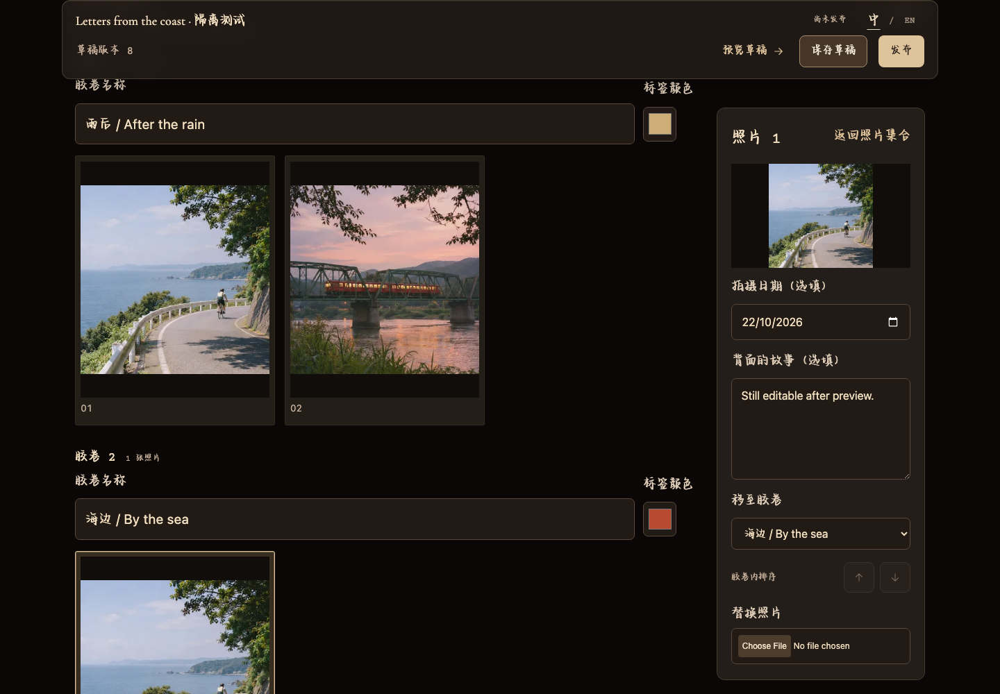

# Film For Us

A personal film album that opens with a letter. Arrange your photographs, tell the stories behind them, and share an interactive darkroom experience with someone important to you.

**[Open the live app](https://filmforus.space/)** · **[Try the demo](https://filmforus.space/demo)** · **[Create your own album](https://filmforus.space/create)** · **[My Studio](https://filmforus.space/dashboard)**

无需在本地运行：直接[体验线上 Demo](https://filmforus.space/demo)，或[登录并创建自己的相册](https://filmforus.space/create)。

## Use it online

1. Explore the [official demo](https://filmforus.space/demo): open the wax-sealed envelope, browse the film rolls, and develop and hang your favorite photographs.
2. Choose [Create a Memory](https://filmforus.space/create) and sign in with the eight-digit code sent to your email. No account password is required.
3. Write your opening letter, name the three rolls, and upload your photos. JPEG, PNG, WebP and HEIC/HEIF are supported; HEIC/HEIF uploads are converted to JPEG.
4. Select a photo in the contact sheet to edit its date, story and roll, change its order, or replace it. Dates and captions are optional.
5. **Save draft** to keep your work. **Preview draft** saves first and opens the real Viewer without publishing. To publish, add a title and letter, name all three rolls, and upload at least one photo to each roll.
6. **Publish**, then copy the generated share link. Return to [My Studio](https://filmforus.space/dashboard) to edit your albums, publish updates, unpublish or delete them.

Drafts and editing are account-protected. A published share link lets anyone who has it view the published album. Saving later draft changes does not update the public version until you publish again. Previously published addresses continue to work when you change the sharing suffix.

The homepage opens the official demo; personal albums have their own `/a/…` links.

## The experience

- A photographic wax seal, a folded paper envelope and a personal opening letter.
- Two 35 mm film rolls, a darkroom developing tray and a drying line for selected prints.
- An instant camera that ejects photographs one at a time.
- A responsive album editor with contact sheets, a selected-photo panel, upload feedback and Save / Preview / Publish controls.
- Chinese and English interface prompts, keyboard controls and reduced-motion support.

The **中 / EN** control changes interface text and remembers the choice in that browser. The brand and your own titles, letters, roll names and captions stay as authored. Browser-level automatic translation is separate and may translate those words too.



[Mobile screenshot](previews/album-editor/mobile.png) · [Editor implementation and verification](docs/album-editor-ui.md)

## Run locally — contributors

The online links above work without installation. For development, use **Node.js 24** and **pnpm**:

```sh
pnpm install --frozen-lockfile
pnpm build
node scripts/preview-phase4.mjs
```

Open `http://127.0.0.1:4184/`. This disposable local environment uses embedded PostgreSQL, synthetic authentication and in-memory media storage. It does not need hosted credentials or send email. Sign in with a test address ending in `@example.test` and the local-only code `12345678`; then use Create or My Studio. Stop with **Ctrl+C**. Test albums and sessions are discarded when the process ends.

`pnpm dev` is available for an explicitly configured backend. The live service uses Supabase email-code authentication, PostgreSQL metadata and private Cloudflare R2 media; it does not use the older owner-password/Blob setup. For a connected local environment, use separate development resources and the environment template in `.env.example`. Keep credentials in ignored server environment files.

## Verify

```sh
pnpm check
pnpm test
pnpm test:browser
node scripts/check-album-editor-browser.mjs
```

The browser commands require Playwright browsers. If they are not installed:

```sh
pnpm exec playwright install chromium webkit
```

`pnpm test:browser` builds and runs the existing Viewer/account flow. The editor regression command reuses that build and checks photo edits, uploads and retry, replacement, sorting, save failures, private Preview, publication, and desktop/tablet/mobile layouts. Both suites use disposable local fixtures rather than production accounts or albums.

## Architecture and documentation

The frontend uses TypeScript and native HTML/CSS. Vercel hosts the app and Node.js API; Supabase provides authentication and PostgreSQL; photos are kept in private Cloudflare R2 storage. Owner-scoped server checks and database row-level security protect editing and drafts. Public viewing uses the published snapshot.

- [Viewer design, interactions and asset provenance](docs/viewer-implementation.md)
- [Typography, font resources and licensing notes](TYPOGRAPHY.md)
- [Album editor behavior, screenshots and test coverage](docs/album-editor-ui.md)
- [Phase 4 configuration and release runbook](docs/phase-4-release.md)
- [Phase 4 verification record](docs/phase-4-verification.md)
- [Earlier multi-album editor history](docs/multi-album-editor-phase-3.md)

The release runbook includes historical migration procedures; ordinary builds do not perform migrations. Configure separate development/preview services before testing a hosted backend. The branch-specific UI Preview is an isolated demonstration with uploads disabled and changes reset on navigation; use the local fixtures for persistence tests.
